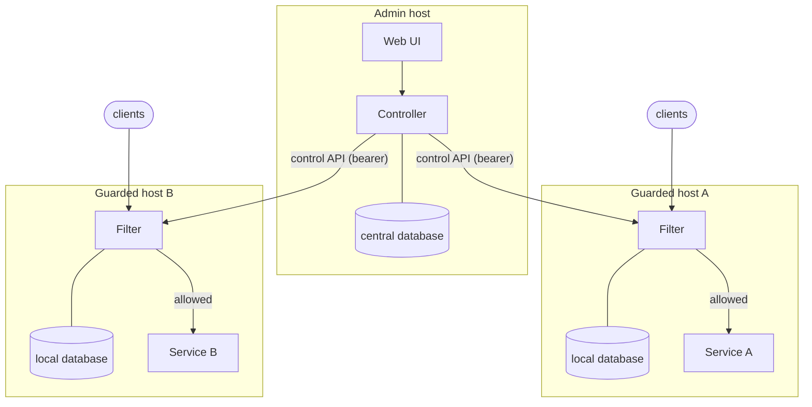
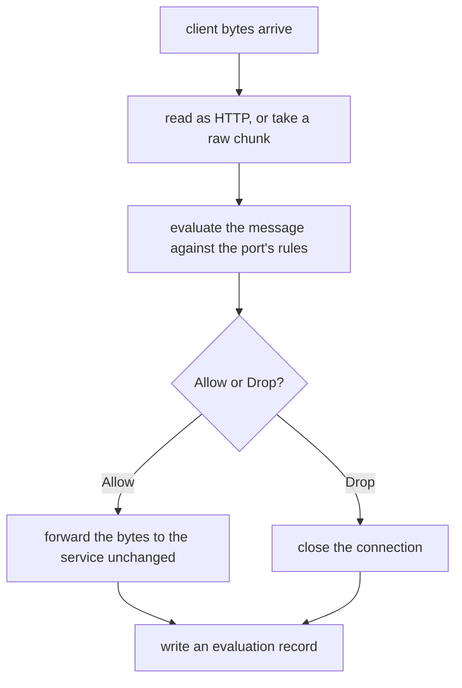
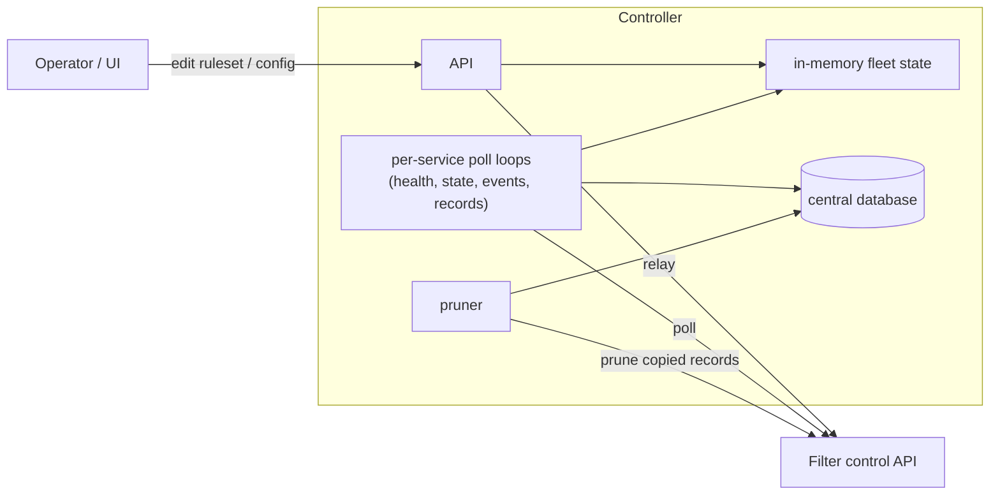

# Architecture

sinkhole is one codebase that builds two programs and a shared library.

- **filter**: the proxy and rule engine that sits in front of a service.
- **controller**: the orchestrator that manages a fleet of filters and aggregates their data.
- **shared**: the common wire model both programs depend on, so they speak byte-identical JSON (the rule model, evaluation records, ECAM events, request and response envelopes, and the auth, hashing, and time helpers).

## Topology

Each filter exposes a small control API (by default on port `7001`) that only the controller calls. The controller exposes the operator and UI API (by default on port `7000`). Clients only ever reach a filter's public data ports, never its control API.

## How a request is handled

Only allowed bytes are forwarded. A drop closes the connection. Either way, every message produces an evaluation record, which is written to the filter's local database (and to stdout in debug mode).

## How the controller manages the fleet

The controller is the single source of truth for which filters exist. It runs a set of background loops per filter that poll for health, state, events, and records, and it mirrors everything into the central database. Operator edits enter through the API and are relayed to the affected filter.

## Read on

- [Filter](filter.md): how traffic flows, the rule engine, and live reload.
- [Controller](controller.md): services, the poll loops, and the relay model.
- [Data and persistence](persistence.md): storage, hydration, centralization, and pruning.
