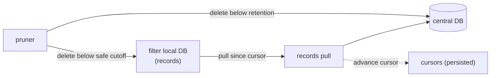

# Data and persistence

This page explains how sinkhole stores data, how a filter restores itself on boot (hydration), and how storage is kept bounded over time (pruning and retention). The environment variables that tune all of this are described in [Environment variables](../configuration/env.md), which points back here for the reasoning.

Both binaries use SQLite, in WAL mode. There are two databases:

- the filter's local database, one per guarded host, holding its own records plus the per-port ruleset and config so it can restart on its own;
- the controller's central database, the mirror of every filter's records and events, for fleet-wide analysis.

The default locations are under `sinkhole-data/`.

## One writer per database

Neither binary opens connections all over the place. Each database has a single owner: one task holds the only connection, and everything that needs to write sends it a request on a queue, which it applies one at a time. That keeps concurrent work from fighting over the database and avoids the "database is busy" errors you get when several writers hit SQLite at once.

Records are written in batches. A filter buffers incoming records and flushes them in one transaction when the buffer fills or on shutdown, rather than writing a row at a time.

## What the filter stores

The filter's database holds three things:

- the records, one row per evaluated message, with the full record kept as JSON so nothing is lost (indexed by port and time, so the controller can pull efficiently);
- the history of rulesets deployed to each port;
- the history of per-port config (name, comment, color, enabled scopes).

The ruleset and config tables are append-only: every accepted change adds a row, so you keep an archive of everything ever deployed to a port. The most recent row for a port is the active one, and that is the only row hydration reads. A restart does not add a row, so the history grows only on real edits. `DELETE /db/clear` wipes it.

## Hydration (filter boot)

Hydration is **on by default** (`SINKHOLE_FILTER_DB_HYDRATE`, opt-out). On startup the filter reads the saved rulesets and port configs from its local database and loads them back into memory: for each known public port it restores the ruleset and the port config (name, comment, color, enabled scopes).

This means a filter that restarts comes back up already enforcing its last ruleset, without waiting for the controller to re-push it, which matters on a guarded host that can reboot on its own. Hydration restores rules and config only. Historical records are left in the database; the controller pulls those, they are not loaded back into memory.

!!! warning "Keep hydration on"
    The controller is pull-only: it never re-pushes rulesets when a filter reconnects, and it does not store rulesets itself. A filter's policy survives a restart only through this hydration. If you turn it off, a restarted filter comes back up with empty rulesets, meaning open, and the controller will not restore them. It will instead sync down to that empty state. Keep `DB_HYDRATE` on unless you have a specific reason not to.

## Controller fleet hydration

The controller persists its tracked fleet, meaning each managed service's connection details and display metadata, in its own table. This is the mirror image of filter hydration: it lets the controller bring the whole fleet back after a restart, including services added at runtime and any names or colors set on them. It is controlled by `SINKHOLE_CONTROLLER_DB_HYDRATE` (on by default).

On boot, with hydration on:

1. It loads the saved fleet. A read failure or an invalid row (empty id or token, malformed URL) is fatal: the controller refuses to start rather than serve a partial fleet.
2. It merges the services declared in the environment on top:
    - an id that exists only in the environment is added and saved, so the environment seeds the fleet once;
    - an id that exists in both must have a matching `url` and `token`. If they disagree, the controller stops at boot and tells you to fix the environment or turn hydration off; it never silently picks one. The display name and other metadata always come from the saved row.

All of these checks happen at startup, before serving. Once running, the controller does not crash over fleet issues.

At runtime the table stays in step with the fleet: adding a service saves its row, editing its metadata updates it, and deleting a service removes the row (its records, events, and cursors stay, so re-adding the same id later still resumes). With hydration off, the table is dormant and the fleet is whatever the environment declares, lost on restart.

!!! note
    A service listed in the environment is re-seeded on every boot, so deleting it through the API does not stick while it is still in the environment. To remove it for good, drop it from the environment too. Tokens are stored in the controller's database on the admin host, the same trust level as the environment that already holds them.

## Centralization (controller pull)

The controller's per-service loops pull from each filter and write into the central database, keeping a cursor per stream so each pull resumes where the last one stopped.

- For records, it keeps a cursor per service and port (the highest timestamp it has pulled, plus one) and asks the filter only for newer rows. Each record is stored along with link rows for its drop reasons and markers, so the central database stays queryable.
- For events, it keeps one cursor per service.

The cursors are persisted, so re-adding a service or restarting the controller resumes from the saved position instead of re-pulling the filter's entire history.



## Pruning and retention

A single background loop keeps both stores from growing without bound. It wakes every `PRUNE_INTERVAL_SECS` (default 600, so ten minutes) and does two independent jobs. If both retention windows are `0`, the loop never runs.

**Filter-side pruning** uses `RETENTION_FILTER_SECS` (default 600, so ten minutes; `0` prunes as soon as data is centralized). For each port the controller works out how far back to keep and asks the filter to delete records older than that. The cutoff is clamped so it can never pass what the controller has already pulled:

```
safe_cutoff = min(now - retention_filter, records_cursor - 1)
```

So a filter never loses a record the controller has not pulled yet, even with a short retention. This keeps the guarded host's disk in check while the controller stays the durable archive.

**Central-database retention** uses `RETENTION_DB_SECS` (default `0`, keep forever; set it to cap history). The controller deletes its own centralized records older than that window.

!!! note "If the controller is offline"
    Pruning is periodic and controller-driven, and it is bounded by the pull cursor. It is a retention policy, not a real-time quota. If the controller is offline for a long time, the filter's local database simply grows until the controller returns and the next prune cycle runs.

Filters also expose `DELETE /db/clear` and database health and stats endpoints for manual operations; see the [Filter API reference](../pages/reference/swagger/openapi-filter.md).
