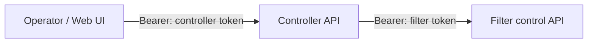

# Authentication

Every request between the web UI, the controller, and the filters carries a bearer token in the `Authorization` header. There is no query-string fallback. Outside debug mode the defaults are fail-closed: a node with no token configured will not serve.

## The two tokens



There are two independent secrets:

- The controller token is what the operator and the web UI send to the controller. The controller stores only its sha256 hash (`SINKHOLE_CONTROLLER_AUTH_TOKEN_HASH`, or it hashes `SINKHOLE_CONTROLLER_AUTH_TOKEN` at startup).
- Each filter has its own token for its control API. The filter stores only the hash. The controller holds each filter's plaintext token so it can call that filter, and that plaintext, once hashed, must equal the filter's `AUTH_TOKEN_HASH`.

So the same value lives as plaintext on the controller (to send) and as a hash on the filter (to check). To produce a hash from a token:

```bash
printf '%s' '<plaintext>' | sha256sum
```

A node hashes the token presented on each request and compares it to the stored hash. Hashes are lowercase hex sha256.

## Fail-closed behaviour

| Mode | Token set? | Result |
|---|---|---|
| any | yes | Enforced: the correct token is allowed, anything else gets a `401`. |
| `DEBUG=true` | no | Auth disabled, with a warning. Local development only. |
| `DEBUG=false` | no | The controller refuses to start; a filter still comes up but returns `503` on every request. |

The controller fails closed at startup, so a misconfigured controller never runs. A filter fails closed per request instead, so its data plane can still come up while you fix the token.

!!! warning
    Do not run a real deployment with `DEBUG=true`. It disables the no-token guard and makes CORS permissive.

## CORS

CORS only affects browsers. The server-to-server calls between the controller and the filters are not subject to it. Only the controller has a CORS layer, because the web UI talks only to the controller. Filters have none, since a browser never reaches them.

### Controller

`SINKHOLE_CONTROLLER_CORS_ORIGIN` is a comma-separated list of allowed origins. It only matters for a *separate* frontend; the bundled UI (`SERVE_FRONTEND`, on by default) is same-origin and needs no CORS.

- Set: only those origins are allowed (honored regardless of the bundled UI).
- Unset while serving the bundled UI: same-origin only. The UI works, and any cross-origin request is denied. No CORS headers are emitted.
- Unset with `DEBUG=true`: permissive, for local development.
- Unset with `DEBUG=false` **and** `SERVE_FRONTEND=false`: the controller refuses to start. Permissive CORS is never allowed in production.

### Filter

A filter has no CORS layer. The web UI never talks to a filter directly; it talks to the controller, which relays to filters over the trusted control network. A filter's reachability and token are checked controller-side when you add it (the "check health" option), not from the browser. Sending no CORS headers means a browser cannot use a filter cross-origin, which is the intent. The filter's own Swagger UI at `/docs` is same-origin and needs no CORS.

See [Environment variables](env.md) for the full variable list.
