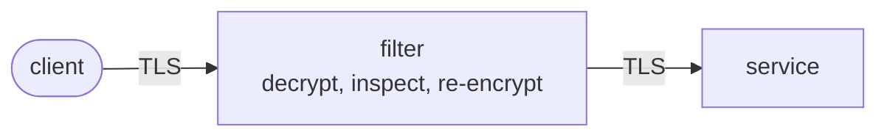

# TLS termination

A public data port can be configured as a TLS service. The filter terminates the client's TLS, inspects and matches the decrypted traffic like any other, then re-encrypts it onto a fresh TLS connection to the service. Configure it with `SINKHOLE_FILTER_TLS_MAP`:

```bash
SINKHOLE_FILTER_TLS_MAP="8443:/certs/site.pem:/certs/site.key"
```

Each entry is `public_port:cert_path:key_path`, comma-separated for several ports:

- `public_port` is the TLS port. It must also appear in [`LISTEN_MAP`](env.md), since TLS is layered on top of an existing data port.
- `cert_path` is a PEM certificate chain. You give the filter the service's real certificate so it presents the genuine one to clients and stays invisible.
- `key_path` is the matching PEM private key (PKCS#8, PKCS#1, or SEC1). If you only have the key, the cert tool shipped with the filter can generate a self-signed certificate from it.

Both files must exist and be readable at boot, or the filter refuses to start.

!!! note "One certificate per port"
    There is no SNI and no certificate upload through the controller in this version. Each TLS port serves exactly one certificate.

## How it works



A TLS port is encrypted on both legs, with the filter in the middle. On the client side it **terminates** TLS: it completes the handshake using the service's certificate and key, and decrypts the traffic. It runs those decrypted bytes through the normal parse, evaluate, and record path, exactly as it would for a plaintext port. Then on the service side it **re-encrypts**: it opens a separate TLS connection to the service and forwards the bytes over it. The decrypted form exists only inside the filter; from the client's point of view it is talking to the service directly.

On the re-encrypt leg the filter does not verify the service's certificate. That hop is inside the operator's trust boundary, a local service whose key the operator already holds, and its certificate is usually self-signed or issued for a name the filter is not dialing. A stricter policy, such as pinning or full verification, could be added later.

`GET /version` reports `tls: true` or `false` for each port, so the controller and UI can show which ports terminate TLS.
