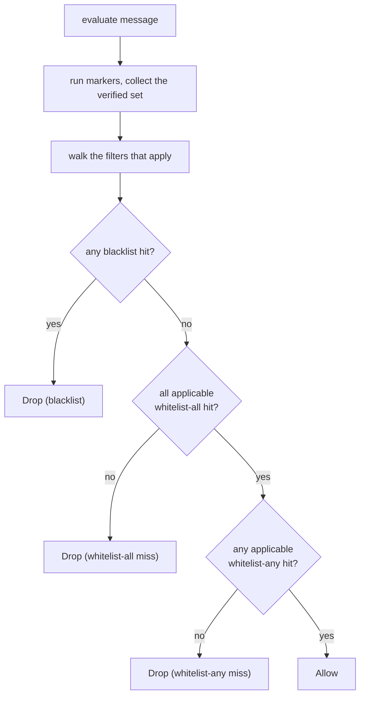

# Evaluation semantics

This is how the filter turns a single message into a decision. The rules you write are described in [Rule model](rules.md); this page is about how they are applied.

Evaluation depends only on the ruleset and the message itself. The filter looks at no other state while deciding, so the same ruleset and the same message always produce the same result. Timing matchers read a timestamp taken once when the message is handled, so even those are deterministic.

## The two phases

For each message, in order:

### Markers first

Every enabled marker whose direction matches the message is checked. If its matcher is satisfied, that marker is remembered as verified. Markers never decide anything; they only record what is true about the message.

### Then filters

The filters are walked in order. For each enabled filter whose direction matches:

- It runs only if its gates are met: all of its `needed_markers_all` were verified, and, if `needed_markers_any` is set, at least one of those was verified. A filter whose gates are not met is skipped, and a skipped filter counts toward nothing.
- When a filter that does apply has its matcher satisfied, that hit is recorded according to the filter's mode (blacklist, whitelist-all, or whitelist-any).
- The first blacklist hit stops the walk. The message is already going to be dropped, and nothing later can turn that back into an allow.

## Reaching the decision

After the walk, in this order:

1. If any blacklist filter hit, the message is dropped.
2. Otherwise, if any whitelist-all filters applied and not all of them hit, the message is dropped, because a required check did not pass.
3. Otherwise, if any whitelist-any filters applied and none of them hit, the message is dropped, because none of the allowed cases matched.
4. Otherwise the message is allowed.

!!! note "Whitelist groups only count the filters that apply"
    A whitelist filter that is gated out adds no requirement. So whitelist-all means "of the whitelist-all filters that actually apply to this message, every one must hit", and gated-out ones are ignored rather than counted as misses. If none apply, the group imposes no constraint.

## What gets recorded

Every evaluation, allow or drop, produces a record with:

- the decision and, for a drop, the structured reason;
- which markers were verified;
- a per-rule breakdown for every rule that ran (its kind, id, mode, whether it applied, its effect, and what its matcher saw), present for both allowed and dropped messages;
- the HTTP metadata when the message parsed as HTTP, the source and destination addresses, and the captured bytes.

A matcher whose field is not present reports skipped rather than a false match. A header regex on a request that lacks that header, for example, neither hits nor errors.

## Forwarding

On an allow, the exact bytes are forwarded to the other side. On a drop, that direction stops and the connection is torn down: the client just sees the connection close. There is no synthetic error response, because the filter works at the stream level, not as an application that can reply.
