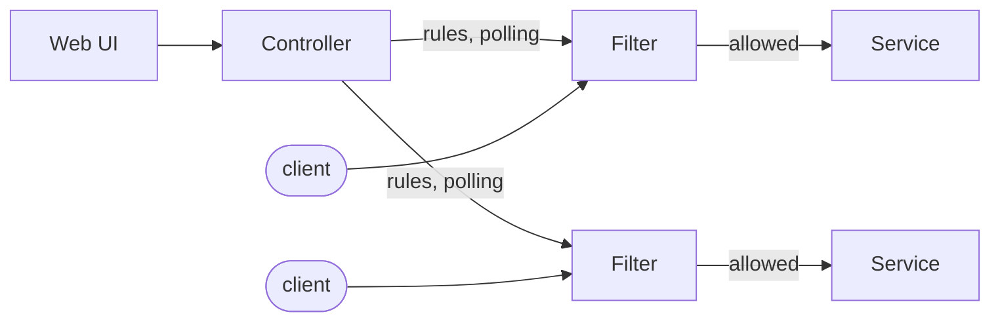

# sinkhole

sinkhole is a programmable traffic filter. It sits in front of a service, looks at every message going in and out, and decides whether to let it through or block it. It was built to guard attack/defense CTF services, where you need to block exploit traffic without taking the service down, and to see what got blocked and why.

It has three parts. The filter is the part that handles traffic (its data plane); the controller is the part that manages the filters (its control plane).

- **Filter**: a transparent TCP proxy that sits in front of one service. It runs a set of rules on every message, forwards what is allowed, blocks the rest, and records every decision it makes.
- **Controller**: one central process that manages all the filters. It pushes rules to them, collects their records, events, and health, and stores everything in one database. It also serves the API the web UI and operators use.
- **Web UI**: a dashboard for reading traffic and editing rules. It talks to the controller, never to the filters.

Each filter goes in front of the service it guards, usually on the same machine as that service, and forwards traffic to it. The controller runs on its own and reaches every filter over the network. The filters do the traffic work; the controller is the one place you manage them from, and where everything they record is collected.

## Putting a filter in front of a service

A filter takes over the public port of the service it guards and forwards traffic to it. You can run it as a single binary or as a container. Either way it is configured entirely through environment variables, so it starts working as soon as it comes up. With no rules loaded it is open: it forwards everything unchanged, byte for byte. You add rules afterwards, while traffic keeps flowing.

See [Installing a filter](operations/installing-a-filter.md).

## What it does

- It is written in Rust, so parsing and rule evaluation are fast enough to run on every message without becoming the bottleneck.
- It accepts the client connection, terminating TLS when the port is set up for it, reads HTTP when the traffic is HTTP, and treats anything else as raw byte chunks.
- It evaluates a per-port ruleset on every message, in both directions, and forwards only what is allowed.
- It records every decision and streams it to the controller, so you can watch traffic as it happens. Each record carries the rules that matched, the reason a message was blocked down to the bytes that triggered it, the HTTP metadata, and the captured payload.
- It reloads rules live, per port, with no downtime. Rules change under running traffic without dropping connections.
- It pulls records, events, and health from every filter into one database, so you can analyze a whole fleet in one place.

## Where to go next

- New here? Start with [Core concepts](getting-started/concepts.md), then the [Quickstart](usage/quickstart.md).
- Writing rules? See [Rule model](filtering/rules.md) and [Evaluation semantics](filtering/evaluation.md).
- Deploying? See [Configuration](configuration/env.md) and [Deployment](operations/deployment.md).
- Want the internals? See [Architecture](architecture/index.md).
- Full endpoint reference: [API](pages/reference/swagger/index.md).
