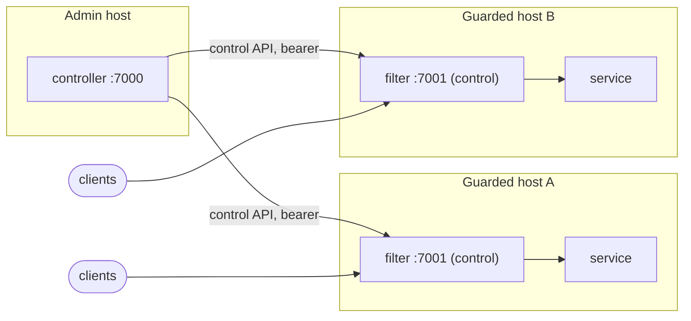

# Deployment

In production each filter runs on the host it guards, and a single controller runs on an admin host and reaches the filters over a trusted control network. The test compose file is not a production topology.

!!! tip "Installing in front of a service"
    The usual way to put a filter in front of a service is to reroute its published port through the filter, a small edit to the service's Compose file, or the autoconfigurer that does it for you. See [Installing a filter](installing-a-filter.md). This page covers the wider production setup.



## Getting the binaries

The repository's Dockerfile builds both binaries and produces a runtime image for each:

```bash
docker build --target filter     -t sinkhole-filter .
docker build --target controller -t sinkhole-controller .
```

You can also run the plain binaries; they are configured the same way, through environment variables. Either way the filter's control API defaults to port `7001` and the controller's API to `7000`, both with `DEBUG=false`.

!!! note "Two ways to ship the web UI"
    The **release binaries** (built by `scripts/build_release.sh`) embed the web UI directly into the controller, so a single binary serves both the API and the UI (`SERVE_FRONTEND` is on by default; see [Web UI](#web-ui)). The **Docker image above does not** bundle the UI (it keeps the image lean and the build fast); run it with a separate frontend and `SERVE_FRONTEND=false`, as the controller example below does.

## Deploy a filter

On each guarded host:

```bash
docker run -d --name sinkhole-filter \
  -e SINKHOLE_FILTER_UPSTREAM_HOST=127.0.0.1 \
  -e SINKHOLE_FILTER_LISTEN_MAP="80:8080" \
  -e SINKHOLE_FILTER_CONTROL_BIND="0.0.0.0:7001" \
  -e SINKHOLE_FILTER_AUTH_TOKEN_HASH="$(printf '%s' "$FILTER_TOKEN" | sha256sum | cut -d' ' -f1)" \
  -v sinkhole-data:/app/sinkhole-data \
  -p 80:80 -p 7001:7001 \
  sinkhole-filter
```

Things to get right:

- Expose the data ports to clients, but keep the control port reachable only by the controller (a private network or a firewall rule). It is not a public endpoint.
- The filter only ever sees the token hash. Keep the plaintext for the controller's service config.
- To guard an HTTPS service, give the filter the service's certificate and key with `TLS_MAP`. See [TLS termination](../configuration/tls.md).
- Put the filter's database on a volume (mount `sinkhole-data/` or set `DB_PATH`), and keep hydration on (the default) so the filter re-enforces its last ruleset after a reboot. See [Data and persistence](../architecture/persistence.md).

## Deploy the controller

On the admin host:

```bash
docker run -d --name sinkhole-controller \
  -e SINKHOLE_CONTROLLER_BIND="0.0.0.0:7000" \
  -e SINKHOLE_CONTROLLER_AUTH_TOKEN="$CTRL_TOKEN" \
  -e SINKHOLE_CONTROLLER_SERVE_FRONTEND="false" \
  -e SINKHOLE_CONTROLLER_CORS_ORIGIN="https://admin.example.com" \
  -e SINKHOLE_CONTROLLER_SERVICES='[{"id":"edge","url":"http://10.0.0.5:7001","token":"'"$FILTER_TOKEN"'"}]' \
  -v sinkhole-data:/app/sinkhole-data \
  -p 7000:7000 \
  sinkhole-controller
```

The Docker image has no embedded UI, so this disables the bundled UI and points CORS at the separate frontend you serve. If you instead run a **release binary**, drop both of those lines: the UI is bundled and served same-origin by default (see [Web UI](#web-ui)).

Things to get right:

- In production the controller refuses to start without an auth token. It also requires a CORS origin **unless it is serving the bundled UI**. Here the UI is decoupled, so set the frontend's origin explicitly. See [Authentication](../configuration/auth.md).
- Each service's `token` is that filter's plaintext token; its sha256 must equal the filter's `AUTH_TOKEN_HASH`.
- You do not have to declare every filter here. Services can be added, removed, and reconfigured through the API at runtime, and the controller remembers where it left off, so a re-added service resumes instead of re-pulling its history.
- Tune `RETENTION_FILTER_SECS`, `RETENTION_DB_SECS`, and `PRUNE_INTERVAL_SECS` for your disk budget. See [Data and persistence](../architecture/persistence.md#pruning-and-retention).

## Web UI

The controller can serve the operator web UI itself, or you can run it separately. The two modes are mutually exclusive in practice and differ only in `SERVE_FRONTEND` and `CORS_ORIGIN`.

**Bundled (default).** A release binary embeds the UI and serves it under `/ui` on the controller's own port, same origin as the API. Just open `http://<controller-host>:7000`, which redirects to `/ui/`. Because it is same-origin, no CORS is involved (cross-origin requests are denied), so you do not set `CORS_ORIGIN`. This is the simplest deployment: one binary, one port, one token.

**Decoupled.** Set `SERVE_FRONTEND=false` and host the frontend elsewhere (the Docker image, a static host, or the Vite dev server). The browser then calls the controller cross-origin, so you must set `CORS_ORIGIN` to the frontend's origin. Build the static assets with `cd frontend && npm run build` and serve `frontend/dist` however you like.

Either way the API itself is unchanged and still requires the controller's bearer token; serving the UI does not expose anything new.

## Hardening

- Never run with `DEBUG=true` in production. It disables the no-token guard and makes CORS permissive.
- Keep filter control APIs off the public internet.
- Give the controller's own API a strong token. If you run a decoupled frontend, also set a strict `CORS_ORIGIN`; the bundled UI is same-origin and needs none.

The full variable list is in [Environment variables](../configuration/env.md).
