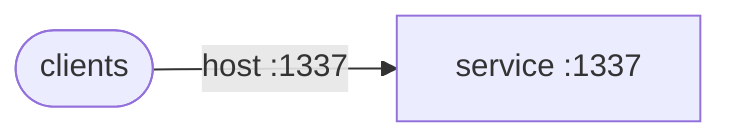
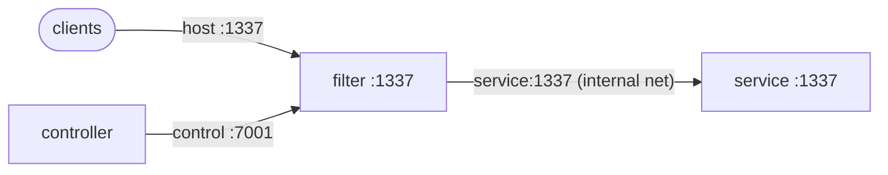

# Installing a filter

Putting sinkhole in front of a service is a change to its Docker Compose file: you route the service's published port through a filter container that forwards to the original service. There is no code change and no rebuild, just an edit to the compose file, and it is easy to automate.

## The idea

A service usually publishes its port straight to the host:



sinkhole inserts itself in between. The filter takes over the published host port and forwards to the service over the internal Compose network. The service stops publishing to the host and becomes reachable only from inside:



From the outside nothing changes: same host, same port. The filter relays bytes exactly, so a filter with no rules behaves the same as the bare service.

## The Compose edit

There are two changes. Stop the service from publishing to the host, exposing it on the internal network only, and add a filter service that publishes the port and forwards to the service.

Before, the service's own compose:

```yaml
services:
  service:
    image: my-service
    ports:
      - "1337:1337"     # host -> service, directly
```

After:

```yaml
services:
  service:
    image: my-service
    expose:
      - "1337"          # internal network only; no longer host-published

  sinkhole-filter:
    image: sinkhole-filter
    depends_on: [service]
    environment:
      SINKHOLE_FILTER_UPSTREAM_HOST: service           # the Compose service name
      SINKHOLE_FILTER_LISTEN_MAP: "1337:1337"          # public:upstream
      SINKHOLE_FILTER_CONTROL_BIND: "0.0.0.0:7001"
      SINKHOLE_FILTER_AUTH_TOKEN_HASH: "${FILTER_HASH}"
    volumes:
      - ./sinkhole-data:/sinkhole-data
    ports:
      - "1337:1337"     # host -> filter (was the service's)
      - "7001:7001"     # control API, reachable by the controller only
```

That is the whole installation. `docker compose up` now brings the service up behind the filter. The [test stack](../usage/quickstart.md) is a working example of this shape.

## Doing it automatically

You do not have to make this edit by hand. sinkhole ships an autoconfigurer that reads a service's Compose file, finds its published ports, rewrites them to run through a filter, and writes the result back, keeping a `.bak` of the original. It shows the before-and-after port plan and asks for confirmation before writing. A companion tool produces a self-signed certificate for a TLS port from an existing private key. Both are small command-line tools shipped with a release, meant to be copied onto the box you are deploying on.

!!! note
    For a box that exposes several ports across different services, the autoconfigurer routes each port to its own upstream, so a single filter can guard the whole box.

## Open by default

The filter is configured entirely through environment variables (see [Environment variables](../configuration/env.md)), so the moment the stack comes up the filter is already running and forwarding. It just has no rules yet, so it passes everything. An empty ruleset means open.

The order is simple: bring the stack up, and the service is immediately reachable through the filter (open); then add rules through the controller whenever you want, and the filter starts enforcing them. Installing the filter and writing the rules are separate steps, so installing it never takes the service down and never blocks traffic before you have written anything. Rules are added and changed under live traffic, with no downtime (see [live reload](../architecture/filter.md#live-reload)).

## Wiring it to the controller

The filter now serves traffic on its own. To manage it from the controller, make its control port (`7001`) reachable from the admin host, and register the filter as a service, either in the controller's configuration or at runtime through the API, using the filter's address and token. The name you give it there is how you refer to this filter from then on. See [Deployment](deployment.md) and [Authentication](../configuration/auth.md).

!!! warning
    Publish the data port or ports to clients, but keep the control port off the public internet. Restrict it to the controller's network. It is a management endpoint, not part of the service.
